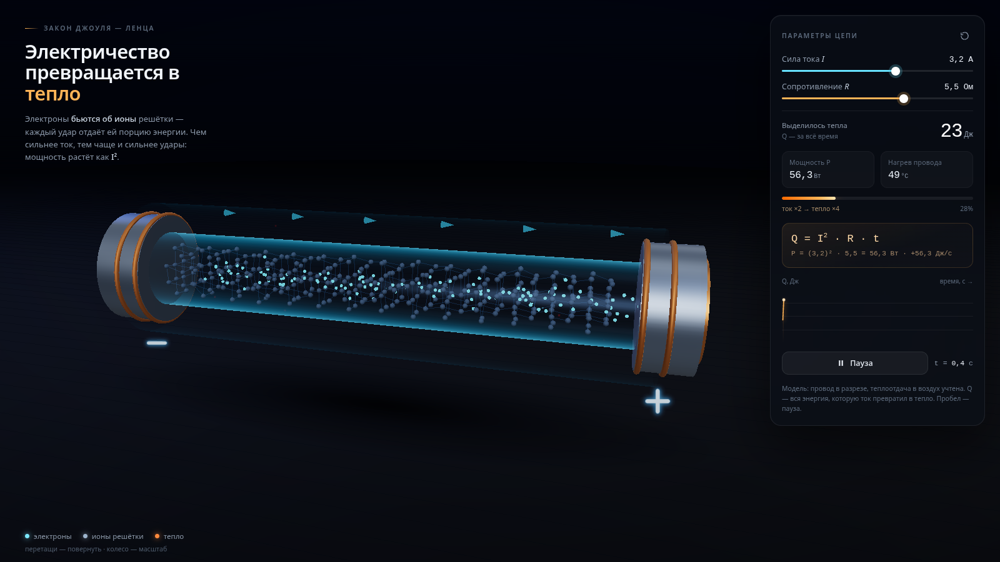
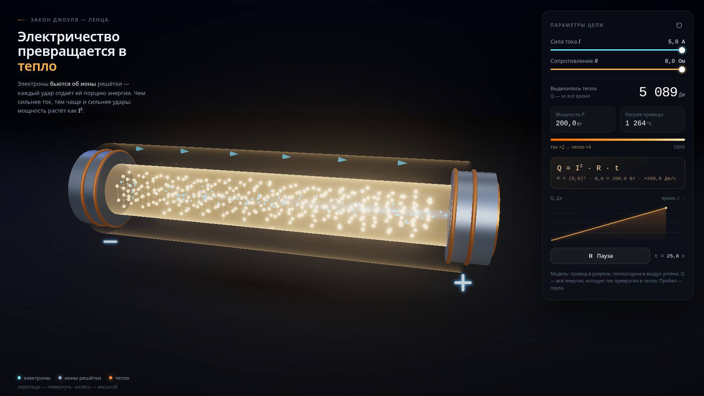

# Joule Lab — закон Джоуля–Ленца в 3D

Интерактивная модель теплового действия тока. Провод показан в разрезе:
видно электроны, кристаллическую решётку и то, как энергия тока превращается
в тепло.




## Запуск

Откройте `index.html` двойным щелчком — всё собрано в `app.js`, интернет не нужен.

Либо через локальный сервер:

```bash
bun run serve   # http://localhost:5173
```

## Что показывает

- **Микроуровень** — электроны (голубые) дрейфуют сквозь решётку и рассеиваются
  на ионах (серые). Каждое столкновение — вспышка: кинетическая энергия переходит
  в колебания решётки.
- **Макроуровень** — провод нагревается, решётка колеблется сильнее, провод
  светится, вверх поднимаются частицы тепла.
- **Числа** — `Q = I²Rt`, мгновенная мощность `P = I²R`, нагрев и график
  накопленного тепла.

Ползунки тока и сопротивления меняют сцену в реальном времени; пробел — пауза,
`R` — сброс. Мышью сцену можно вращать и приближать.

## Физика

Мощность: `P = I² · R`, тепло: `Q = ∫P dt`. Нагрев провода — сосредоточенная
модель с теплоотдачей в воздух:

```
C dT/dt = P − k (T − T_air)
C = 0.8 Дж/К, k = 0.16 Вт/К, T_air = 22 °C
```

Поэтому `Q` растёт линейно при постоянных `I` и `R`, а температура выходит на
полку, когда теплоотдача уравновешивает нагрев. Свечение — визуальная
аппроксимация нагрева, а не строгая кривая абсолютно чёрного тела.

## Структура

```
index.html        интерфейс и стили
src/main.js       сцена, симуляция, шейдеры
app.js            собранный бандл (генерируется)
tools/serve.mjs   локальный статический сервер
tools/shot.mjs    скриншоты через playwright-core
```

Пересборка после правок `src/main.js`:

```bash
bun run build
```
